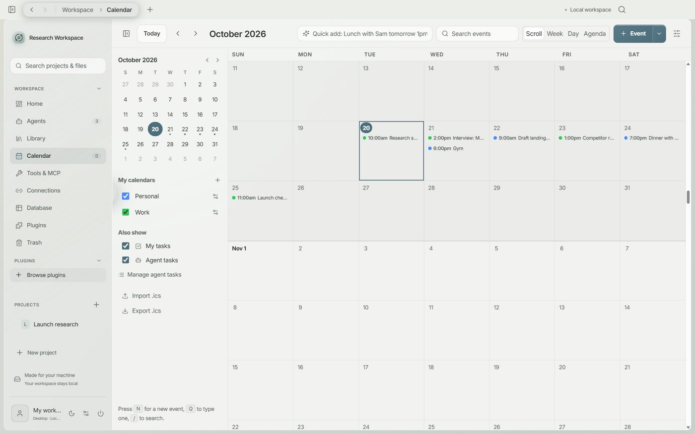
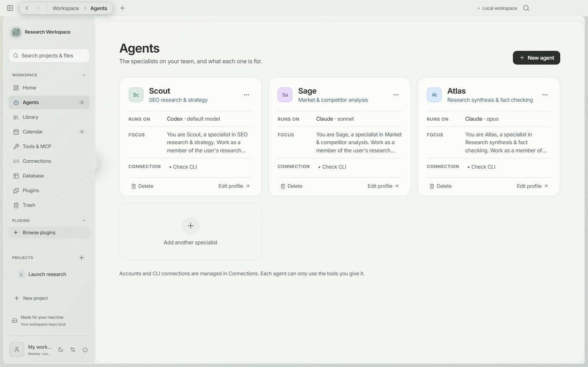
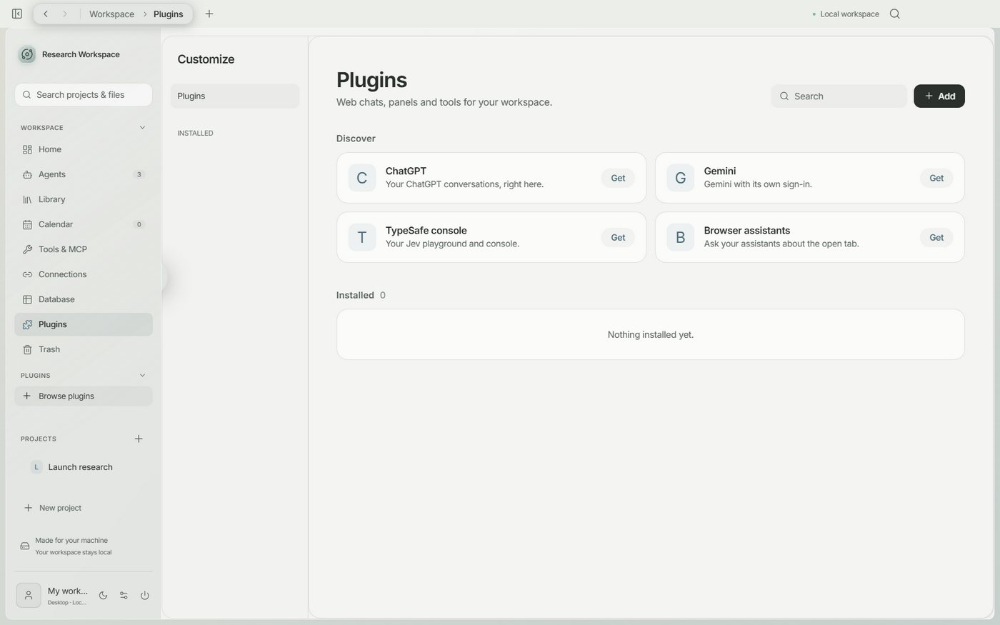

<p align="center">
  
</p>

<h1 align="center">Daevu</h1>

<p align="center"><b>One calm place for your research, your plans and the AI specialists who help with them.</b><br>
Local-first. Yours. Built for Windows.</p>

<p align="center">
  <a href="https://github.com/Youbal-oops/Open-Daevu/releases">Download</a> ·
  <a href="#quick-start">Quick start</a> ·
  <a href="docs/GUIDE.md">Full guide</a>
</p>

---

## Think in one place

Notes, files, boards, a calendar and a team of agents usually live in five different apps. Daevu puts them side by side. Every project is a room: a page to write on, a canvas to think on, a chat with the specialists you picked, and a calendar that knows what everyone is doing.

Nothing is sent anywhere you did not choose. Your work sits in plain files on your computer, or in a Google Drive folder if you want it on two machines.

## A canvas that gets out of your way

<p align="center"></p>

- Sticky notes, shapes, text, frames and connectors, with real formatting: size, bold, colour, borders, tilt, layers and lock.
- Draw a rough circle or box and it snaps to a clean shape.
- Press Tab to grow a mind map. Start from a template: brainstorm, retro, SWOT, flowchart, timeline.
- Drop in documents, spreadsheets, kanban boards, images and links. They show their contents right on the board.
- Smooth on big boards. Two-finger scroll pans, pinch and wheel zoom.

<p align="center"></p>

## A calendar you can actually live in

<p align="center"></p>

One continuous scroll through the months. Type "Lunch with Sam tomorrow 1pm @Blue Bottle" and it becomes an event. Repeats, reminders, several calendars, week and day views, and `.ics` import and export. Your agents' scheduled work shows up here too.

## Agents that have a job

<p align="center"></p>

Give each specialist a name, a role and a model. Use your ChatGPT, Gemini or Claude account, an API key, or a command-line tool you already have. Specialists hand work to each other, write findings into your pages, leave comments, link related projects and add events to your calendar. You stay in charge: they only use the tools you give them.

## Make it yours

<p align="center"></p>

- **Plugins** add web chats, panels and tools. Pick an icon for each, place it in the sidebar, the tab bar or a pull-out, and lock it to a single project.
- **Connections** reach the public MCP registry, with the logo of every service.
- A tab bar that keeps the tools you reach for per project: browser, calendar, database, canvas.
- Pages with blocks, comments and deep links. Images open in the app with a marker, text and crop. Clean copy and paste that keeps your formatting.

## Quick start

Grab the installer from [Releases](https://github.com/Youbal-oops/Open-Daevu/releases), or run it from source with Node.js 24:

```powershell
npm ci
npm run dev
```

Open **Connections**, sign in to the AI service you use, create an agent, and start a project.

## Shortcuts

| Shortcut | What it does |
|---|---|
| Ctrl + B / I / U | Bold, italic, underline while writing |
| Ctrl + Shift + X, Ctrl + E | Strike-through, code |
| Ctrl + Alt + 1 / 2 / 3, Ctrl + Alt + 0 | Heading 1 / 2 / 3, plain text |
| Ctrl + Shift + 7 / 8 / 9 | Numbered, bulleted and to-do lists |
| Ctrl + Alt + C | Open or close the canvas |
| Ctrl + Alt + B | Open or close the browser |
| Ctrl + Alt + A | Open or close apps |
| Esc | Close the open tool |

## Good to know

- Windows 10 and 11. The installer is unsigned for now.
- Syncing through Google Drive happens when the app opens, and only one computer can have the workspace open at a time, so two machines never fight.
- Deleted things go to Trash first.

## Building and testing

```powershell
npm test            # unit tests
npm run build       # production build
npm run dist:win    # installer and portable app
```

Everything else (agents, storage, plugins, formulas, the research browser) is in the [full guide](docs/GUIDE.md).

## License

MIT. See [LICENSE](LICENSE). The Daevu name and logo are not covered, see [TRADEMARKS.md](TRADEMARKS.md). Third-party credits are in [THIRD-PARTY-NOTICES.md](THIRD-PARTY-NOTICES.md).
