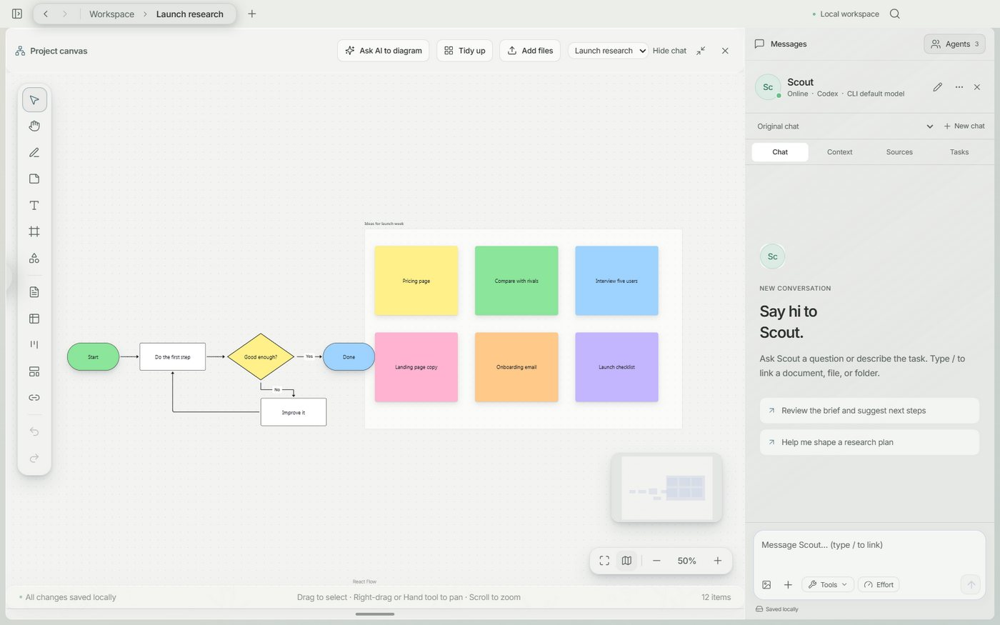
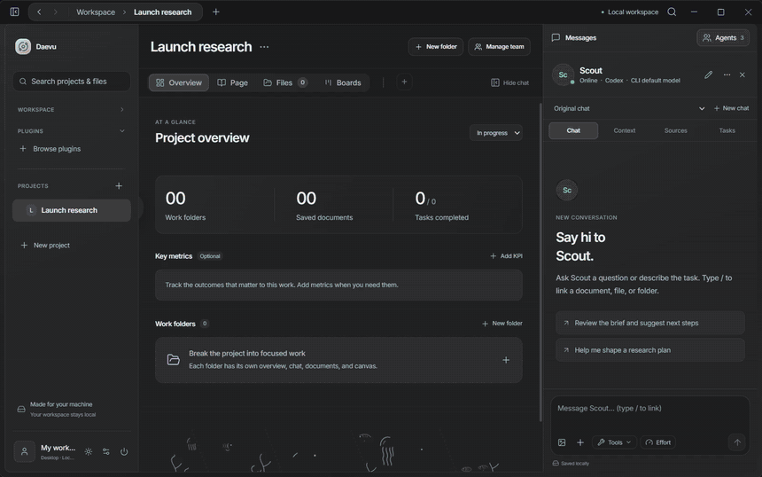

<p align="center">
  
</p>

<h1 align="center">Daevu</h1>

<p align="center">A local-first Windows desktop workspace for projects, documents, spreadsheets, a canvas and a calendar.</p>

<p align="center">
  <a href="https://github.com/Youbal-oops/Open-Daevu/releases/latest">Download</a> ·
  <a href="docs/GUIDE.md">Guide</a> ·
  <a href="PLUGINS.md">Plugins</a> ·
  <a href="https://github.com/Youbal-oops/Open-Daevu/issues/new/choose">Report a bug</a>
</p>

Daevu is for people who want their project notes, source files, planning and small custom tools in one desktop workspace. Projects can have work folders, their own documents, boards, browser tabs and optional agent conversations. You can use the core workspace without an AI account.

## Project status

The core feature set is complete. Development is focused on bug fixes, performance, reliability and compatibility. New functionality should primarily be built as plugins or project apps; changes to core extension APIs can be discussed when needed.

Youbal describes the initial development as roughly six weeks, beginning privately before this public repository was created. Public Git history starts with the 1.0.0 commit on 20 October 2026; it does not represent the full private development period. The project was developed with extensive AI coding assistance. That assistance is part of its history, not a substitute for reviewing changes or recording what was actually tested.

## Install

1. Open [Releases](https://github.com/Youbal-oops/Open-Daevu/releases/latest).
2. Download the Windows x64 **Setup.exe** installer, or **Portable.exe** to run without the installer.
3. Launch Daevu and choose a theme, storage location and whether to enable AI agents. New workspaces start empty.

The builds are unsigned, so Windows may show a security warning. Check the download's repository and release before deciding whether to run it. Keep a portable EXE in a stable location if you use startup or app shortcuts. Existing releases and their original notes are linked in [release context](docs/RELEASE-NOTES.md).

## Core workspace

- **Pages and documents:** block editing, tables, comments, links, pictures, undo/redo and autosave. Notes can be exported as Markdown.
- **Spreadsheets:** multiple sheets, formulas, filters, cell references and Excel/ODS/CSV import and export. This is a limited calculation engine, not full Excel compatibility.
- **Canvas:** shapes, sticky notes, freehand drawing, connectors, templates and embedded project items.
- **Boards and databases:** Kanban, basic bar/line/area/pie charts, dashboards and project-scoped SQLite tables.
- **Calendar:** events, tasks, repeats, reminders, week/day views and `.ics` import/export. Agent schedules are optional and need the app running.
- **Files and browser:** upload source files, preview supported formats, annotate images and keep project browser tabs and saved sources.

Screenshots use sample content and may show earlier navigation. They illustrate the interface, not verified live provider connections.

<p align="center"></p>

## Plugins and project apps

These are different extension types:

| Type | Purpose | How it runs |
| --- | --- | --- |
| **Project app** | A tracker, calculator, dashboard, game or other tool owned by a project | Local HTML/CSS/JS/TS/JSX files, bundled by the host, with the `rw` SDK for project data and app state |
| **Workspace plugin** | Reusable panels, board types, file editors, spreadsheet formulas, themes or browser extensions | Installed from a folder, ZIP, supported public GitHub package or the bundled catalog; permissions are reviewed before installation |

Project apps have draft, preview and publish steps. Publishing makes a version available inside Daevu; it does not deploy a website. Apps can open in their own Daevu window and have Windows shortcuts. You can write them yourself or use a configured agent. Three.js, Phaser, React and React DOM are available to the bundler.

App and HTML-plugin frames restrict direct network and host access; approved SDK operations still read or change project data. Website plugins load external sites, and browser-script plugins execute within matching web pages. Review the permissions and code of extensions you install. See the [app guide](docs/GUIDE.md#app-studio-and-launcher-v0100) and [plugin manifest and SDK](PLUGINS.md).

<p align="center"></p>

[Wing Hop source](plugin-examples/wing-hop) and [project-dice plugin](plugin-examples/project-dice) are examples in this repository, not preinstalled workspace content.

## Optional integrations

- **AI agents:** configure an API key, supported account sign-in or installed CLI. Profiles choose models, prompts and tools; access and billing depend on the provider. See [account setup](ACCOUNT-CONNECTIONS.md).
- **MCP services:** connect and authorize services separately, then choose which tools an agent can use. Provider login does not import another application's connectors.
- **AI websites:** the ChatGPT and Gemini plugins show the providers' websites with separate browser sessions. They are independent of API/account agents; sign-in and composer automation depend on the websites.
- **Additional charts and browser assistants:** install the relevant optional plugins from Discover.
- **Google Drive:** select a workspace folder managed by Drive for desktop. Legacy workspaces use a one-PC-at-a-time workflow; the optional shared-editing format supports simultaneous devices. Drive controls delivery, and conflict review may be needed. See [storage and shared editing](docs/GUIDE.md#google-drive-workspace-connection).
- **Python:** a manual spreadsheet script panel uses a separately installed Python 3 interpreter. Scripts run with your Windows user permissions, not in an application sandbox.

## Data and limitations

Workspace data is stored locally by default, including JSON records, document/file copies and project databases. Back up the **entire workspace** while Daevu is closed. A shared Drive workspace also needs its `.research-sync` data. Provider credentials are stored separately with Windows credential protection; project files themselves are not encrypted by Daevu.

Local-first does not mean network-free. Packaged builds check GitHub for updates automatically. Browsing, provider connections, MCP and optional website plugins contact their services; enabled Drive storage syncs through Drive for desktop. Agent requests include relevant project context. See [data and trust boundaries](SECURITY.md#data-and-trust-boundaries).

Large documents, imports, spreadsheets and charts can still be slow. Imported spreadsheets are bounded and unsupported formulas may not preserve their original results. Built-in previews do not replace every format's native editor. Third-party sign-in, tools and model availability need verification with your own accounts. Current problems belong in [Issues](https://github.com/Youbal-oops/Open-Daevu/issues); tests and their limits are recorded separately from feature claims.

## Run from source

Use Windows x64 and Node.js 24, matching the Windows build workflow:

```powershell
git clone https://github.com/Youbal-oops/Open-Daevu.git
cd Open-Daevu
npm ci
npm run dev
```

`npm run dev:web` is a browser preview with local browser storage. It does not provide native desktop integrations.

```powershell
npm run check:docs
npm test
npm run build
```

See [development and repository layout](docs/DEVELOPMENT.md), [contributing](CONTRIBUTING.md) and [release checks](docs/RELEASING.md). [Historical validation notes](VALIDATION.md) are retained as records of earlier development, not current test guarantees.

## Contributing and security

[Report bugs or compatibility problems](https://github.com/Youbal-oops/Open-Daevu/issues/new/choose) with reproduction steps, app version and Windows version. Small fixes, performance measurements, documentation corrections and extension examples are welcome. Discuss substantial core changes first; [CONTRIBUTING.md](CONTRIBUTING.md) explains the current priorities and review expectations.

For sensitive reports, follow [SECURITY.md](SECURITY.md). Do not post credentials or private workspace contents in issues.

## License

[MIT](LICENSE). The Daevu name and logo have separate [trademark terms](TRADEMARKS.md). [Third-party notices](THIRD-PARTY-NOTICES.md) and the existing visual assets are retained.
